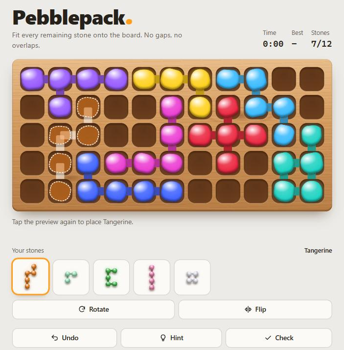

# Pebblepack

A packing puzzle for the browser. Fit twelve stone pieces onto a 5×11 wooden
board: no gaps, no overlaps.

**Play it:** https://pebblepack.netlify.app/

## How to play

- Each puzzle starts with some stones already on the board. Choose how many
  (0 to 11) with the slider: fewer stones means a harder puzzle.
- Drag a stone from your tray onto the board, or tap it and then tap where it
  goes. Rotate and flip with the buttons, by tapping the stone again, or with
  the R and F keys.
- Stuck? **Check** tells you whether your board can still be finished, without
  giving anything away. **Hint** places one correct stone.
- The clock starts on your first move. Your best time for each starting-stone
  count is saved on your device (solves that used hints don't count), and an
  unfinished puzzle is still there when you come back.

It works on phones and desktops, with touch, mouse or keyboard.

## The problem underneath

Fitting a fixed set of irregular pieces into a grid with no gaps and no
overlaps is an exact-cover problem. The engine solves it with a backtracking
search:

- **Fill the first empty hole.** Every hole must be covered by some piece, so
  the search only tries pieces that cover the first empty hole. That cuts the
  branching enormously compared with trying every piece everywhere.
- **Bitmask boards.** The 55 holes are stored as two 32-bit integers, so
  checking whether a piece fits is a single bitwise AND.
- **Dead-region pruning.** After each placement, any sealed-off gap must be
  exactly fillable by the sizes of the pieces still unused (sizes 3, 4 and 5).
  Precomputed subset sums make this a lookup, and it cut the worst-case time to
  prove a board unsolvable from about 3 seconds to under 1.
- **Puzzles are always solvable.** Each one is cut from a random full solution
  (a seeded, shuffled search), keeping a chosen number of its pieces.
- **The page never freezes.** Check and Hint run in a Web Worker, and an answer
  for a board that changed in the meantime is thrown away.

## How it was built

This started as a solver for a physical puzzle I own: I wanted to know whether
a position on my real board could still be finished. That turned into a
question worth more than a solver: could the same engine power an original
game? Pebblepack is the result, with its own name, look and piece colours.

Built with AI coding assistance (Claude Code). My work was the product side:
deciding to turn the solver into a game, choosing the name and the wooden-board
visual direction, specifying the interaction (drag as well as tap, Check and
Hint, best times that ignore hinted solves), and testing every step on a real
phone before moving on.

## Stack and tests

Static HTML, CSS and JavaScript. No build step, no dependencies. Deployed on
Netlify from this repository.

- `engine.js`: piece shapes, solver, puzzle generation, Check and Hint
- `engine-worker.js`: runs Check and Hint off the main thread
- `game.js`: the board, the tray, drag and tap, timer, saving
- `index.html`: markup and styles

Engine tests (16) run in Node:

    node tests/engine.test.js

An end-to-end browser test plays several games with every input method. With
the site open, run this in the browser console:

    await (await import('/tests/browser-smoke.js')).run()
